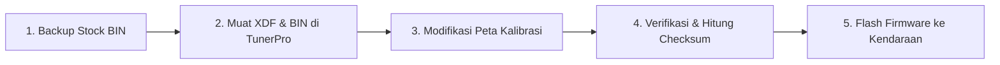

# 📖 Panduan Praktis Remap ECU Menggunakan TunerPro RT

Dokumen ini disusun sebagai panduan langkah demi langkah (*step-by-step tutorial*) bagi tuner, mekanik, dan pehobi otomotif dalam membaca, memodifikasi, dan memverifikasi kalibrasi ECU sepeda motor dan mobil menggunakan file `.bin` dan `.xdf` yang tersedia dalam database ini.

---

## 🛠️ 1. Persiapan Awal Software & Hardware

### Software yang Dibutuhkan:
1. **TunerPro RT v5.00+**: Software editor peta gratis dan standar industri untuk kalibrasi otomotif.
2. **Kalkulator / Plugin Checksum**:
   - Untuk Honda/Yamaha: Tersedia pada folder `00_TOOLS_AND_CHECKSUM_ENGINES/MOTO_ECU_CHECKSUM/`.
   - Untuk Toyota Denso: Gunakan engine pada `00_TOOLS_AND_CHECKSUM_ENGINES/TOYOTA_DENSO_XDF_TOOL/`.
   - Untuk BMW & VAG: Plugin bawaan TunerPro atau tool baris perintah.
3. **Hardware Flasher**:
   - **K-Line**: Kabel VAG-COM FTDI FT232RL (K-Line Pin 7, Ground Pin 4/5, +12V Pin 16).
   - **CANBUS / J2534**: Tactrix Openport 2.0, Scanmatik 2 Pro, atau hardware flash OEM.

---

## 🚀 2. Alur Kerja Kalibrasi (Workflow 5 Langkah)



### Langkah 1: Selalu Simpan File Asli (Original Backup)
- Sebelum melakukan perubahan apa pun, buat salinan cadangan (*backup copy*) file biner asli kendaraan Anda.
- Beri nama cadangan dengan awalan `STOCK_ORIGINAL_...bin`. Jangan pernah mengedit langsung file cadangan utama!

### Langkah 2: Membuka File di TunerPro
1. Jalankan **TunerPro RT**.
2. Pilih menu **XDF** -> **Select XDF...** -> Pilih file definisi `.xdf` yang sesuai dengan kode part ECU dan model kendaraan Anda.
3. Pilih menu **File** -> **Open Bin...** -> Pilih file biner `.bin` yang ingin Anda kalibrasi.
4. Periksa **Parameter Tree** di bilah kiri. Parameter akan terorganisir ke dalam kategori:
   - `Fuel Calibration` (Peta Injeksi Bahan Bakar)
   - `Ignition Timing` (Derajat Pengapian BTDC)
   - `Rev & Speed Limiters` (Pembatas Putaran Mesin & Kecepatan)
   - `VTEC / VVA Variable Cam` (Titik Buka Klep Variabel)
   - `Sensors & Scaling` (Kalibrasi Sensor TPS, MAP, IAT, ECT)
   - `Configuration & DTC Switches` (Sakelar Immobilizer IMMO OFF, O2, EGR)

---

## 📊 3. Cara Modifikasi Peta Kalibrasi Utama

### A. Peta Bahan Bakar (Base Fuel Injection Map)
- **Tampilan Sumbu**:
  - Sumbu X: Putaran mesin (**RPM**).
  - Sumbu Y: Bukaan gas (**TPS %**) atau Tekanan Udara (**MAP kPa**).
  - Nilai Sel (Z): Durasi injeksi dalam mikrodetik (*microseconds*) atau rasio ekuivalensi bahan bakar.
- **Strategi Kalibrasi**:
  * **Putaran Bawah & Menengah (1,500 – 5,000 RPM)**: Tambahkan +2% hingga +4% untuk mengeliminasi gejala tarikan bawah brebet / *lean stumble* akibat regulasi emisi pabrik yang terlalu irit (*stoichiometric lean*).
  * **Putaran Atas & Full Throttle (WOT >80% TPS)**: Targetkan rasio udara-bahan bakar (AFR) optimal tenaga:
    - Mesin Bensin Naturally Aspirated (NA): **12.8 : 1 – 13.0 : 1** (Lambda ~0.87).
    - Mesin Bensin Turbo: **11.5 : 1 – 11.8 : 1** (Lambda ~0.78) untuk mencegah detonasi/knocking.
    - Mesin Diesel Common Rail (2KD/1GD/4N15): Tambahkan durasi injeksi utama (*main injection duration*) sebesar 4-6% pada zona beban tinggi dan naikkan tekanan *rail pressure* sebesar +100 hingga +150 bar.

### B. Peta Pengapian (Ignition Advance BTDC)
- Nilai sel menunjukkan derajat poros engkol sebelum titik mati atas (**° BTDC**).
- **Aturan Keselamatan**:
  * Naikkan pengapian secara bertahap: maksimal **+1° hingga +2°** per sesi uji coba.
  * Hanya naikkan pengapian jika kendaraan menggunakan bahan bakar beroktan tinggi (**RON 95 / RON 98**).
  * Jika mendengar bunyi ketukan mesin (*knocking/pinging*), segera mundurkan pengapian sebesar 2°!

### C. Pembatas Putaran Mesin (Hard & Soft Rev Limiter)
- Buka kategori `Rev & Speed Limiters`.
- Terdapat dua jenis limiter:
  1. **Soft Rev Limiter (Ignition Retard)**: Mundurkan waktu pengapian untuk memperlambat akselerasi mesin sebelum batas maksimal.
  2. **Hard Rev Limiter (Fuel Cutoff)**: Memutus total semprotan injektor.
- **Rekomendasi Aman**:
  * Motor harian 150cc (Vixion, R15, Sonic, CBR150R): Maksimal **11,500 – 11,800 RPM** (bawaan pabrik ~10,500 RPM) jika per klep masih standar.
  * Motor 250cc 2-silinder (CBR250RR MC51): Standar 14,000 RPM, dapat dinaikkan aman ke **14,500 – 14,800 RPM**.
  * Motor 250cc 4-silinder (Ninja ZX-25R): Standar 17,000 RPM, aman hingga **17,800 RPM**.

### D. Titik Pindah Katup Variabel (VTEC / VVA Switch)
- **Yamaha VVA (Aerox, NMAX, R15 V3/V4, WR155)**:
  - Bawaan pabrik aktif pada 6,000 RPM.
  - Untuk akselerasi lebih responsif pada camshaft racing, titik aktif VVA dapat diturunkan ke **5,200 – 5,500 RPM**.
- **Honda VTEC (B16, B18, K20, K24)**:
  - Bawaan pabrik aktif pada 5,800 RPM.
  - Dapat diturunkan ke **4,500 – 5,000 RPM** dengan catatan tekanan oli mencukupi (>55 psi) dan manifold intake telah di-porting.

### E. Penonaktifan Sensor & Immobilizer (IMMO OFF)
- Pada kategori `Configuration & DTC Switches`, ubah nilai parameter:
  - `Immobilizer enabled`: Ubah dari `1` (True) menjadi `0` (False) untuk menghidupkan mesin saat kunci hilang atau untuk mesin balap swap sasis.
  - `Secondary oxygen sensor enabled`: Ubah ke `0` untuk knalpot *full-system racing* tanpa *catalytic converter*.

---

## 🔒 4. Verifikasi dan Koreksi Checksum

> [!CAUTION]
> **Peringatan Fatal**: Jangan pernah melakukan *flash* file `.bin` yang telah diedit ke dalam ECU tanpa melakukan kalkulasi ulang nilai **Checksum**! Jika checksum tidak cocok, unit mikrokontroler ECU akan menolak booting dan menyebabkan ECU mati total (*hard brick*).

### Prosedur Checksum:
1. Simpan perubahan biner Anda di TunerPro (**File** -> **Save Bin As...**).
2. Jika XDF telah memuat konfigurasi blok `<XDFCHECKSUM>`, TunerPro akan secara otomatis mengkalkulasi ulang nilai checksum pada alamat yang ditentukan saat file disimpan.
3. Untuk ECU yang membutuhkan algoritma khusus (seperti Bosch MED17 TriCore RSA signature atau Renesas RL78 block-sum):
   - Gunakan skrip kalkulator di `00_TOOLS_AND_CHECKSUM_ENGINES/MOTO_ECU_CHECKSUM/`:
     ```bash
     python3 /root/ecu_master_database/00_TOOLS_AND_CHECKSUM_ENGINES/MOTO_ECU_CHECKSUM/verify_checksum.py my_remap.bin
     ```

---

## ⚡ 5. Tips Pencegahan Kegagalan Flash (Anti-Brick)

1. **Gunakan Sumber Daya Stabil (Battery Stabilizer)**:
   - Pastikan tegangan aki motor/mobil tidak turun di bawah **12.4 Volt** selama proses *write*. Gunakan *battery charger/power supply* pendukung.
2. **Matikan Semua Aplikasi Berat**:
   - Tutup software antivirus, screen saver, dan aplikasi latar belakang pada laptop saat proses transfer data K-Line/CAN.
3. **Patuhi Batas Memori Area Tulis**:
   - Untuk Yamaha 64KB, hanya tulis zona kalibrasi `0x1800 - 0x7FFF`. Jangan menulis area bootloader yang terlindungi!
